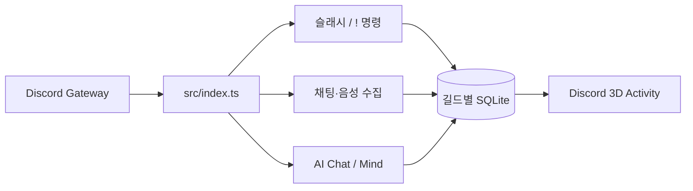

# Giinii Bot

Discord 채팅·음성 기록을 집계하고, 친밀도 시각화·룰렛·AI 대화/기억을 제공하는 **Bun + TypeScript** 봇입니다. [사용자용 안내](README_USER.md)

## 빠른 시작

Bun 1.3+, Discord 봇 토큰이 필요합니다. Discord 개발자 포털에서 **Message Content Intent**를 활성화하세요.

```bash
git clone git@gitlab.com:blond11qq/giinii_bot.git
cd giinii_bot
cp .env.example .env
# .env: DISCORD_TOKEN, ADMIN_USER_ID 지정
bun install --frozen-lockfile
bun run check && bun test
bun run start
```

`ADMIN_USER_ID`는 봇 소유자의 **Discord 사용자 ID**입니다. 미설정 시 소유자 전용 명령은 모두 거부됩니다. AI 대화에는 `CHAT_OPENROUTER_API_KEY`(또는 `OPENROUTER_API_KEY`)가 필요합니다. 비밀값을 Git에 커밋하지 마세요.

## 명령어

### 슬래시 명령어 `/`

| 명령어 | 기능 | 범위 |
| --- | --- | --- |
| `/친밀도 @유저` | 함께 음성 채널에 있었던 시간 TOP 21 | 모든 서버 |
| `/친밀도그래프` | 2D 친밀도 그래프 | 모든 서버 |
| `/통화량` | 음성 체류 시간 TOP 21 | 모든 서버 |
| `/통계` | 통화·채팅·종합 통계 카드 | 모든 서버 |
| `/친밀도그래프3d` | Discord 3D Activity | 전용 서버 |
| `/관리자머리끄댕이` | 역할 룰렛 실행 | 전용 서버 |

### 접두사 명령어 `!`

**일반 사용자** (아래 항목 중 `!help`는 모든 서버, 나머지는 전용 서버)

| 명령어 | 기능 |
| --- | --- |
| `!help` | 모든 명령어 안내 |
| `!model [모델 ID]` | AI 모델 조회·변경 |
| `!reasoning [none|minimal|low|medium|high|xhigh|max]` | 추론 수준 조회·변경 |
| `!memory list` | 내 AI 기억 조회 |
| `!memory delete <번호>` | 내 기억 삭제 |
| `!memory clear confirm` | 내 기억 전체·관계 추정 초기화 |
| `!memory visibility <번호> <private|shareable>` | 내 기억 공개 범위 변경 |

**Discord 서버 관리자** (전용 서버)

| 명령어 | 기능 |
| --- | --- |
| `!mind status` | AI 판단 엔진 상태 |
| `!shared-memory list` | 서버 공용 기억 조회 |
| `!shared-memory add <fact|preference|server_convention> [@유저] <내용>` | 기억 추가 |
| `!shared-memory edit <번호> <내용>` / `delete <번호>` | 수정·삭제 |
| `!shared-memory nickname @유저 <별명>` | 공용 별명 설정 |
| `!타겟 지정 @역할` / `삭제` / `조회` | 룰렛 사용 역할 |
| `!관리자_타겟 지정 @역할` / `삭제 @역할` / `조회` | 룰렛 대상 역할 |
| `!들낙감지설치` / `!들낙시간지정 <초>` | 음성 입퇴장 감지 설정 |
| `!들낙무시 [채널ID]` / `!들낙무시 해제 <채널ID>` | 감지 제외 채널 |

**봇 소유자만** (`.env`의 `ADMIN_USER_ID`와 일치하는 사용자)

| 명령어 | 기능 |
| --- | --- |
| `!sync` | 슬래시 명령 동기화 |
| `!서버목록` | 가입 서버와 기록 현황 |
| `!서버별명령어 [서버]` | 서버별 슬래시 명령 허용 상태 |
| `!서버별명령어 <서버> disable|enable <명령어>` | 슬래시 명령 on/off |
| `!도움` | 소유자용 운영 도움말 |

`!서버별명령어`는 **슬래시 명령만** 제어합니다. `!` 명령은 Discord 권한·전용 서버 조건으로 제어하며, 소유자 계정에는 서버 관리자 기능도 허용됩니다. `!model`·`!reasoning` 변경은 재시작 전까지만 유지됩니다. `!` 명령 답변은 채널에 공개됩니다.

전용 서버 ID는 `src/command-rules.ts`의 `ALLOWED_GUILD_ID`입니다.

## 삭제된 슬래시 명령 정리 (일회성)

봇을 새 버전으로 배포한 뒤 한 번 실행하세요. 아래 7개만 **전역 및 봇이 참여한 길드**에서 삭제하고, 나머지 슬래시 명령과 Activity 진입점은 보존합니다.

```bash
bun run cleanup:slash --dry-run  # 삭제 대상 확인
bun run cleanup:slash            # 실제 삭제
```

대상: `/model`, `/reasoning`, `/mind`, `/memory`, `/shared-memory`, `/타겟`, `/관리자_타겟`. 다시 실행해도 안전합니다. 봇 시작 시 `syncCommands`도 현재 등록 목록으로 동기화합니다. 스크립트는 실제 Discord API에 접속하므로 봇 토큰이 필요합니다.

## 배포 및 검증

**Docker Compose** (Linux/macOS, `.env` 작성 후):

```bash
docker compose up -d --build
docker compose logs -f --tail=100 bot
# 업데이트: git pull --ff-only && docker compose up -d --build
```

`./data`는 SQLite·미디어 영속 볼륨입니다. 별도 백업이 필요합니다. Activity는 `bun run build:activity` 후 `ACTIVITY_ENABLED=true`와 Discord OAuth·HTTPS 프록시를 설정해야 열립니다.

```bash
bun run check            # TypeScript 검사
bun test                 # Bun 테스트
bun run build:activity   # 3D 프런트 빌드
```

GitLab CI는 위 검사·테스트·빌드를 실행합니다. 원본 CodeGraph 분석은 수동 작업입니다.

## 코드 흐름



핵심: `src/commands.ts`(슬래시 등록), `src/prefix-commands.ts`(`!` 분기), `src/admin-commands.ts`(소유자 권한), `src/chat/`, `src/mind/`, `src/storage.ts`, `activity/`.

**데이터 주의:** 봇이 읽을 수 있는 채팅, 첨부 파일, 음성 채널 체류 기록이 저장될 수 있습니다. 음성 **오디오 녹음**은 하지 않습니다. `!memory clear confirm`은 개인 AI 기억을 지우지만 원본 채팅·미디어·백업은 삭제하지 않습니다.
