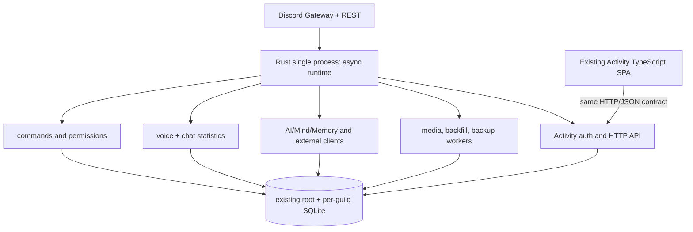

# Approved Rust backend design — giinii_bot

## Scope and goals
Replace the backend (Discord gateway/events, slash/prefix commands, voice/chat statistics, AI/Mind/Memory, media/backfill/seed/restore workers and Activity HTTP API) with a single Rust service, retaining **existing TypeScript/Three.js Activity SPA** and **existing SQLite data files**. For this implementation and review, never switch the deployed bot. Existing Bun/TypeScript backend source is retained during stabilization.

## Existing architecture observed at pinned main 8f17c21059a8
- Entrypoint `src/index.ts` uses `discord.js`, initializes root and per-guild SQLite, Activity HTTP server, backfill and media/seed workers.
- `src/storage.ts` uses `bun:sqlite`, a root database `./data/bot.sqlite` and per-guild `./data/guilds/{guildId}.sqlite`, with transactions and additional schema creation on open.
- `src/chat/` and `src/mind/` implement OpenRouter, decision quotas, visibility and memory.
- `src/activity-web-server.ts` is a `Bun.serve` API and static-file server, using session-token, activity-instance, membership and command permission gates.
- `activity/` is an independent Vite front-end; it continues as TypeScript.
- `Dockerfile` and `docker-compose.yml` run the Bun bot, with `./data:/app/data` persistent volume and host loopback port 8787.
- `main` project has an external CI hub configuration path and commit statuses; `.gitlab-ci.yml` lists Bun typecheck/test/Activity build. All Rust checks are new/planned until evidenced.

## Chosen Rust modular-monolith design

Potential maintained components after testing: Tokio async runtime, Rust Discord client library, rusqlite with owned transactions, Axum HTTP, Serde for JSON, tracing with redaction. Each selected crate/version must be pinned with Cargo.lock and validated in CI before its dependent phase. No claims that they are already installed.

## Concrete interface contracts
- `GatewayEvent` / `CommandRequest` boundaries parse Discord IDs as strings (to avoid 64-bit JSON precision issues), authorize before executing side effects, and drive deterministic handler tests.
- `GuildDb` owns a guild-isolated SQLite connection and atomic transactions, path `data/guilds/{id}.sqlite`. Separate root DB owner follows existing file layout.
- `GraphSnapshot` and `ActivitySession` produce the JSON/endpoints expected by current TypeScript Activity; compare fixture snapshots and negative authorization cases.
- `RuntimeConfig` reads a **new** versioned nonsecret config file and a new secret-only environment namespace (e.g. `GIINII_*`); errors out on missing credentials, and never logs secret values. There is **no compatibility requirement for old env names**. Mapping documented for future operators.
- `BackfillCheckpoint` and `MediaTask` are resumable and idempotent; no duplicate message counts or half-written media after crashes.
- Rust CI must run at exact candidate SHA, with manual and external checks separately identified. `cargo test` without a real executing job is **not** verification.

## Quality and acceptance
- Command names/functionality, authorization, per-guild isolation, state recovery and DB row/data invariants retained; UI unchanged. Small visible improvements allowed and documented, with tests.
- Prefer test-first RED/GREEN/REFACTOR; verify through real CI and precise SHA matching. Code review in two passes: requirements and quality/privacy/security.
- ARM64 final container must actually build/run on ARM64 to claim proof; AMD64 builds and generic YAML parsing cannot substitute.
- TDD stubs are not a shipped implementation. No feature-complete claim until all phases and final integration are verified. Missing live Discord tests remain explicit risk.

## Rollback/cutover (not authorized to execute)
Maintain Bun entrypoint, original Docker Compose and original root/guild DB files untouched until independently approved. Before any future cutover stop old process, take consistent backup of DB/WAL/SHM, seed and media; start Rust only after confirming compatibility; rollback by stopping Rust and restarting Bun from prior image/commit. Never run both Gateway bots against the same token/production DB simultaneously.
